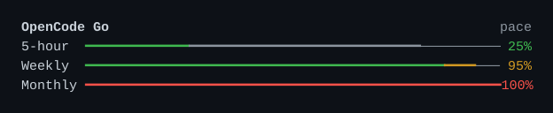
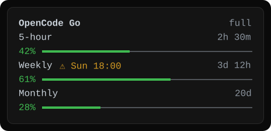
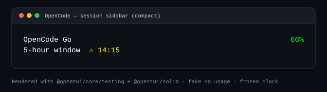

# OpenCode Go Limits

[](https://github.com/987poiuytrewq/opencode-go-usage-limits/actions/workflows/ci.yml)
[](https://www.npmjs.com/package/opencode-go-usage-limits)
[](LICENSE)

A TUI-only [OpenCode](https://opencode.ai) plugin that shows your OpenCode Go
usage in the session sidebar. By default it renders the rolling 5-hour, weekly,
and monthly meters as a pace view that compares each meter with how much of its
window has already elapsed. An optional expanded layout shows the same meters
as two-line bars with the percentage used, a reset countdown, and an estimated
runout warning when usage is on course to hit a limit before it resets; an
optional compact layout collapses to a single healthy status line and expands
to two rows when a meter needs attention.

The npm package and GitHub repository are both named
[opencode-go-usage-limits](https://github.com/987poiuytrewq/opencode-go-usage-limits).

The plugin is deliberately small: it reads the usage meters that OpenCode
already has access to, follows your active OpenCode theme, and does not store or
display API keys, token spend, or billing details.

Pace mode (the default) compares each meter with the elapsed portion of its
window on one composite bar beneath a bold title:



*Pace mode (the default), captured from the real OpenTUI renderer with deterministic fake usage data.*

Expanded mode shows all three Go meters as two-line progress bars with their
reset countdowns:



*Expanded mode, captured from deterministic fake usage data.*

Compact mode is a single line while all three meters are healthy: a normal-text
`OpenCode Go` title on the left and a green `●` indicator on the right. When
any meter is warning or critical, it expands to two rows with a bold title, the
monthly percentage, and the most urgent short-window status:



*Compact mode in the healthy state, captured from deterministic fake usage data.*

## Features

- **All three Go meters** in one sidebar panel: 5-hour, weekly, and monthly.
- **Pace view by default:** a bold title plus one row per meter with a fixed
  label column, a composite bar comparing usage with the elapsed portion of the
  5-hour, weekly, or monthly window, and a right-aligned percentage.
- **Optional expanded mode:** all three meters as two-line bars with the
  percentage used, a responsive `━` / `─` progress bar, and a reset countdown.
- **Optional compact mode:** one healthy status line with a normal-text title
  and a green `●`, expanding to two rows with a bold title, the monthly
  percentage, and the most urgent short-window meter when anything needs
  attention.
- **Runout warnings** projected from average usage since the current window
  began, shown in expanded mode.
- **Theme-aware colors:** success, warning, and error colors from the active
  OpenCode theme.
- **Configurable refresh cadence** with safe bounds, so a typo in the config
  cannot hammer the server.
- **No separate credentials:** the plugin uses OpenCode's client and the
  workspace you are already signed in to.

## Requirements

- **OpenCode V2 with TUI plugin support.** The plugin is developed against
  `@opencode/plugin` 2.3.0, and CI runs the real-host TUI smoke test against
  OpenCode 2.2.7, 2.3.2, and 2.4.2. An older V2 release may not provide the
  `sidebar.content` slot or the experimental usage-limits client method this
  plugin calls.
- **An OpenCode Console workspace with OpenCode Go.** The usage endpoint returns
  no Go meters for workspaces without an active Go subscription, and the panel
  shows an unavailable message instead.
- **[Bun](https://bun.sh) 1.4.4** to install dependencies from source and to run
  the tests. OpenCode provides the runtime for the plugin itself.

## Install

This is a TUI-only package: its `package.json` exports a `./tui` entry and has
no server entry. OpenCode loads TUI-only plugins from the global CLI config
(`cli.json`), not from `opencode.json`.

### From npm

Add the package to `~/.config/opencode/cli.json` (or
`$XDG_CONFIG_HOME/opencode/cli.json` when `XDG_CONFIG_HOME` is set):

```json
{
  "$schema": "https://opencode.ai/v2/cli.json",
  "plugins": ["opencode-go-usage-limits"]
}
```

Or let the OpenCode CLI install and register it:

```sh
opencode plugin add opencode-go-usage-limits
```

Then run `/reload` in the TUI, or restart OpenCode. The **OpenCode Go** panel is
appended to the session sidebar.

The CLI config is global; there is no project-local CLI config file. If the
panel does not appear, see [Troubleshooting](#troubleshooting).

### From a local checkout

1. Clone the repository and install its dependencies:

   ```sh
   git clone https://github.com/987poiuytrewq/opencode-go-usage-limits.git
   cd opencode-go-usage-limits
   bun install
   ```

2. Add the clone's absolute path to the `plugins` array in
   `~/.config/opencode/cli.json` (or `$XDG_CONFIG_HOME/opencode/cli.json` when
   `XDG_CONFIG_HOME` is set):

   ```json
   {
     "$schema": "https://opencode.ai/v2/cli.json",
     "plugins": [
       {
         "package": "/absolute/path/to/opencode-go-usage-limits"
       }
     ]
   }
   ```

3. Run `/reload` in the TUI, or restart OpenCode. The **OpenCode Go** panel is
   appended to the session sidebar.

## Configuration

Options go in the same plugin entry, under `options`. Every option is optional:

```json
{
  "$schema": "https://opencode.ai/v2/cli.json",
  "plugins": [
    {
      "package": "opencode-go-usage-limits",
      "options": {
        "refreshMs": 30000,
        "mode": "pace"
      }
    }
  ]
}
```

`"pace"` is the default layout, so the `mode` line can be omitted. Use
`"expanded"` or `"compact"` to opt into a different layout.

For a local checkout, keep the object entry but point `package` at the clone's
absolute path instead of the npm package name.

| Option | Default | Description |
| --- | --- | --- |
| `refreshMs` | `60000` | How often the sidebar reloads usage, in milliseconds. Values below `15000` are raised to 15 seconds; values above `1800000` are lowered to 30 minutes. A value that is not a finite number falls back to the default. |
| `mode` | `"pace"` | Sidebar layout. `"pace"` shows a bold title plus exactly three one-line rows with a composite usage-versus-elapsed bar per meter. `"expanded"` shows all three meters as two-line bars with reset countdowns and runout warnings. `"compact"` shows a single normal-text title and green healthy indicator while all meters are healthy, and expands to two rows with a bold title, the monthly percentage, plus the most urgent 5-hour or weekly status when any meter is warning or critical. Any value other than the exact strings `"pace"`, `"expanded"`, or `"compact"` falls back to `"pace"`. |

The interval starts when the sidebar panel mounts. Refreshes are skipped while
a previous request is still running, so a slow or offline server cannot build
up a queue of requests. The plugin has no manual refresh command; if you change
`refreshMs`, reload OpenCode to apply the new value.

### Pace mode (default)

Pace mode is the default, so it needs no configuration. It renders four rows: a
bold **OpenCode Go** title, then one row per Go window. Each meter row reserves a
fixed label column, then shows one composite bar that compares usage with how
much of the window has elapsed, then a right-aligned percentage at the sidebar's
right edge:

```text
OpenCode Go
5-hour  ━━━━━━━━━━━━━━━━━━━━━━━━━━━━━━━━━━━━━━━━━━────────── 25%
Weekly  ━━━━━━━━━━━━━━━━━━━━━━━━━━━━━━━━━━━━━━━━━━━━━━━━━─── 95%
Monthly ━━━━━━━━━━━━━━━━━━━━━━━━━━━━━━━━━━━━━━━━━━━━━━━━━━━━100%
```

Set `"mode": "pace"` explicitly if you prefer a self-documenting config.

Every row reserves a label column wide enough for `Monthly` plus one separator,
and the same four-character percentage field, so all three bars start and end
on the same columns and every percentage is right-aligned as `  5%`, ` 25%`, or
`100%`. At the 64-column sidebar width used by the sample, the label takes 8
cells, the bar takes 52 cells, and the percentage field takes 4 cells.

The bar has four segment roles:

- **Green thick (`━`):** usage within the elapsed portion of the window.
- **Muted thick (`━`):** elapsed window that usage has not reached yet, shown
  when you are behind pace.
- **Yellow thick (`━`):** usage past the elapsed portion of the window, shown
  when you are ahead of pace.
- **Empty (`─`):** the remainder of the window.

In the sample, the 5-hour meter is behind pace, so its bar is green up to 25%
and muted thick through the 80% elapsed mark. The weekly meter is ahead of pace
at 95% against roughly 86% elapsed, so green runs to the pace line and yellow
covers the over-pace usage. Monthly is limited, so its entire used segment and
its percentage are red; no separate status text is shown.

The `demo/pace.svg` screenshot above is regenerated by `make demo` from this
deterministic behind/ahead/critical fake dataset.

Elapsed percentage is inferred from the same reset timestamps used by runout
estimates:

- **5-hour:** reset minus 5 hours.
- **Weekly:** reset minus 7 days.
- **Monthly:** the same UTC day and time in the previous calendar month,
  clamped to that month's final day. This is **approximate**: Go resets the
  monthly allowance when the paid period renews, which may not match a calendar
  month.

Elapsed percentages and used percentages are clamped to `0`–`100`. A reset in
the past is treated as 100% elapsed. When the reset timestamp is missing or
invalid, the row falls back to a plain usage bar without a pace overlay. A meter
that the API marks as limited, or one at 100% or more, is always critical: the
used segment and percentage use the theme's error color, so the state does not
depend on color alone.

Like compact mode, pace mode does not wrap at narrow sidebar widths. Widen the
sidebar if a label, percentage, or bar does not fit.

### Expanded mode

Set `"mode": "expanded"` to show each meter on two lines. Expanded mode is
opt-in; new installs get the pace layout.

```text
5-hour                      4h 42m
25% ━━━━━━━━──────────────────────
Weekly                      5d 13h
50% ━━━━━━━━━━━━━━━───────────────
Monthly                         7d
80% ━━━━━━━━━━━━━━━━━━━━━━━━──────
```

- The first line has the meter name and, on the right, the time until the meter
  resets. Countdowns look like `4h 42m`, `5d 13h`, `<1m`, or `now`.
- The second line has the percentage used and a bar that fills according to
  that percentage. The bar shrinks to fit the sidebar and never goes below one
  column. It rounds to the nearest column, so a low percentage can show an
  empty bar.
- Bars use the theme's success color below 80%, its warning color from 80% to
  99%, and its error color at 100% or when the API marks the meter as limited.
- A `⚠` warning appears next to a meter when the plugin projects that the meter
  will run out before it resets.

#### Runout estimate formats

| Meter | Warning format | Example |
| --- | --- | --- |
| 5-hour | Local time, rounded to the nearest 15 minutes | `⚠ 10:45` |
| Weekly | Local weekday and 24-hour time, rounded to the nearest hour | `⚠ Sat 20:00` |
| Monthly | Short UTC date | `⚠ Dec 2` |

### Compact mode

Set `"mode": "compact"` to show a compact status line. While all three meters
are healthy, the panel is a single row with a normal-text `OpenCode Go` title
on the left and a green `●` indicator on the right:

```text
OpenCode Go                                                    ●
```

In this healthy state the title keeps the theme's base text color and normal
weight; only the indicator is green. A meter is healthy when it is not limited,
below 80%, and not projected to run out before it resets. When any meter is
warning or critical, compact mode keeps the detailed two-row output. The first
row shows the bold title and a right-aligned monthly percentage; the second
row shows the most urgent short-window meter (5-hour or weekly), with its
status symbol and either a projected runout or reset detail:

```text
OpenCode Go                                                  66%
5-hour  ⚠ 14:15
```

The monthly percentage is bare: no `Monthly` label and no status symbol. It
uses the theme's success color when the month is healthy, its warning color
when the monthly meter is approaching its limit (80% or more, or projected to
run out before it resets), and its error color when it is exhausted or marked
limited by the API, including limited usage below 100%. Severity on this row is
conveyed by color only, so the value stays a bare percentage:

```text
OpenCode Go                                                  85%
OpenCode Go                                                 100%
```

The second row selects only the 5-hour and weekly meters, using the same urgency
order as expanded mode:

- **`✖` (critical):** a meter the API marks as limited, or one at 100% or more.
  The row reads `<meter> ✖ limit reached`. If several meters are critical, the
  highest percentage wins.
- **`⚠` (warning):** a meter at 80% or more, or one projected to run out before
  it resets. The row shows the projected runout time (for example,
  `5-hour  ⚠ 14:15`) or the reset countdown when there is no projection.
  Among warnings, the earliest projected runout wins; when no warning has a
  projection, the highest percentage wins.
- **`✓` (healthy):** neither short-window meter is urgent. The row reads
  `<meter> ✓ resets <countdown>` for the higher-percentage meter.

Warning rows keep exactly two spaces before `⚠`. On the second row, the meter
label stays in the normal text color and only the status segment (`⚠ 14:15`,
`✖ limit reached`, or `✓ resets 7d`) uses the status color. The symbol, status
text, and theme color always agree, so the mode is readable without color.

Compact mode keeps its other states in two distinct rows as well:

```text
OpenCode Go                                                    …
… loading limits

OpenCode Go                                                    –
– Go usage unavailable

OpenCode Go                                                    ✖
✖ error · limits endpoint offline
```

Loading and unavailable states use muted theme colors; a request error uses the
error color and takes precedence over any stale meter values from an earlier
refresh.

## Runout estimates and display limitations

Runout estimates are a simple linear projection, not a forecast based on
historical samples:

```text
projected time to empty = elapsed time in window × (100 − percent) / percent
```

The window start is inferred from the reset time:

- **5-hour:** reset time minus 5 hours.
- **Weekly:** reset time minus 7 days.
- **Monthly:** the same UTC day and time in the previous calendar month,
  clamped to the last day of that month.

As a result:

- Monthly estimates are approximate. Go's monthly allowance resets when a new
  paid period starts, which may not line up with a calendar month, and the
  plugin can only infer a month-shaped window from the reset timestamp.
- The projection assumes the average rate of usage since the window began
  continues. A quiet period, a burst of activity, or a plan change will move
  the real runout time.
- No runout warning is shown when a meter is already at or over 100%, when the
  API marks it as limited, when usage is zero or invalid, when the reset time is
  missing or in the past, or when the projected runout would happen after the
  reset. In those cases there is either nothing left to project or the window
  resets first.
- Percentages and reset times come from OpenCode and are only as fresh as the
  last refresh. The plugin does not poll outside its configured interval.

The plugin also does **not** display billed spend or remaining balance. It only
renders the three Go usage meters. For account-level spend and balance, use
OpenCode Console: owners and admins can open **Activity › Usage** for cost
breakdowns and **Settings › Billing** for billing and balance; members can open
**My usage** on **Activity** to see their own usage and limits.

## Troubleshooting

| You see | What to do |
| --- | --- |
| No **OpenCode Go** panel | Run `opencode plugin list` to confirm the plugin is listed and active rather than failed or skipped. Confirm the entry in `cli.json` names `opencode-go-usage-limits` (or, for a local checkout, the absolute path to the clone root, the directory containing `package.json`). For a local checkout, also confirm `bun install` has run there. Then run `/reload` or restart OpenCode. Load failures are also written to `~/.local/share/opencode/log/opencode.log`. |
| **OpenCode Go usage is unavailable for this workspace** | OpenCode returned no Go meters. Confirm the workspace has an active OpenCode Go subscription and that OpenCode is signed in to that workspace. A workspace without Go has no allowance to display. |
| A network, authentication, or endpoint error appears in the panel | The panel shows the error message from the usage request. Check your connection and OpenCode sign-in, then wait for the next refresh. If it persists, check the OpenCode log. |
| Usage looks stale | The panel refreshes once per `refreshMs` (60 seconds by default) while the TUI is running. Lower `refreshMs` for a faster cadence, down to 15 seconds, then reload. |
| `refreshMs` has no effect | Put `options` on the matching plugin entry in the global `cli.json`, not in `opencode.json`, and make sure the `package` value names the same package or clone. Non-numeric values fall back to 60 seconds. |
| The monthly warning date looks wrong | Monthly runouts assume a calendar-month cycle. Go resets the monthly allowance when the paid period renews, so treat the monthly warning as an estimate. |
| The bars look short | The bar uses the sidebar's measured width minus the columns reserved for its label and percentage, with a one-column minimum. Widen the sidebar to give the bars more room. |
| The compact rows are cut off | Compact mode clips rather than wraps at narrow sidebar widths. Widen the sidebar if the title, healthy indicator, monthly summary, or short-window detail does not fit. |
| The pace rows are cut off | Pace mode also clips rather than wraps. Widen the sidebar if a label, percentage, or bar does not fit. |
| `mode` is ignored | Use the exact string `"pace"`, `"expanded"`, or `"compact"` in `options` on the plugin entry in `cli.json`. Any other value falls back to `"pace"`, and you must reload OpenCode after changing it. |
| The panel shows pace bars | Pace is the default. Set `"mode": "expanded"` for two-line meters with runout warnings, or `"mode": "compact"` for the healthy status line and compact summary, then reload OpenCode. |

## How it works

The plugin exports a single TUI entrypoint from `src/tui.tsx`. On setup it
registers an append claim for OpenCode's documented `sidebar.content` slot.
When the slot renders, the widget:

1. Calls `context.client.experimental.usage.limits()` for the current location.
2. Displays the returned `go.rolling`, `go.weekly`, and `go.monthly` meters as
   the title plus three composite usage-versus-pace bars by default, or as all
   three two-line meters when `mode` is `"expanded"`, or as the healthy status
   line or detailed monthly summary plus the most urgent short-window meter
   when `mode` is `"compact"`.
3. Refreshes on the configured interval and listens for renderer resize and
   frame events to remeasure the bar.
4. Removes its timer and renderer listeners when the slot is unloaded.

The plugin never reads an API key directly and makes no requests of its own
outside the OpenCode client.

## Development

```sh
make install
```

That installs the dependencies pinned in `bun.lock`. The plugin has no build
step: its `package.json` exports the TypeScript TUI entry directly, and
OpenCode loads it through the `./tui` export.

### Tests

| Command | Runs |
| --- | --- |
| `make test` | Formatting, typecheck, unit tests, and integration tests. No host tools required. |
| `make format-check` | Formatting for the checked source, demo, and config files, and a strict-JSON check of the first JSON example in this README. |
| `make typecheck` | `tsc --noEmit` over `src`, `test`, and `demo`. |
| `make demo` | Renders the expanded, compact, and pace sidebars through the real OpenTUI test renderer with fake usage data and rewrites `demo/expanded.svg`, `demo/compact.svg`, and `demo/pace.svg`. |
| `make test-unit` | Unit tests for settings, compact status selection/formatting, pace math/bars, and usage formatting/estimation. |
| `make test-integration` | Renders the plugin in a test OpenTUI renderer and covers slot registration, expanded, compact, and pace layouts, data loading, error states, refresh, and cleanup. |
| `make test-e2e` | Opt-in real-host smoke test: launches OpenCode in tmux with an isolated HOME/XDG tree and checks that the session sidebar renders the **OpenCode Go** heading. |
| `make ci-tools` | CI-only host setup: installs tmux and `@opencode/cli@$OPENCODE_VERSION` for the E2E matrix. |
| `make verify-version` | CI-only guard that `$(OPENCODE_BIN) --version` matches `OPENCODE_VERSION`. |
| `make e2e-debug` | Prints OpenCode logs from E2E runs that failed and preserved their temporary artifacts. |
| `make ci` | `make install` followed by `make test`; this is what CI's host-free checks job runs. |

`make test` and `make ci` never require tmux or an OpenCode binary. The E2E
suite is opt-in through `E2E=1` and runs in its own CI job.

### Real-host E2E

`make test-e2e` needs:

- **OpenCode V2** on `PATH`, or an explicit binary via
  `make test-e2e OPENCODE_BIN=/path/to/opencode`. The CI matrix covers 2.2.7,
  2.3.2, and 2.4.2.
- **tmux**.
- **Installed dependencies**: run `make install` in the checkout first.

The test never reads your account. It creates a temporary HOME and XDG tree, a
temporary git repository, and a global `cli.json` whose `plugins` entry points
at this checkout's absolute path. It then launches `opencode --standalone` on a
private tmux socket, starts a new session (Ctrl+X then N followed by a one-word
prompt so the session view mounts), and waits for the stable **OpenCode Go**
heading. It does not assert Go credentials, usage values, or network success; a
workspace without Go still renders the heading and an unavailable message.

Extra knobs:

| Variable | Purpose |
| --- | --- |
| `E2E_KEEP=1` | Keep the temporary HOME, repository, log, and pane capture after a passing run. Failed runs keep them automatically. |
| `E2E_PLUGIN_ROOT=/absolute/path` | Point `cli.json` at a different checkout. OpenCode cannot load a plugin path containing `#`, so use this when running from a git worktree whose directory name contains `#`. |
| `OPENCODE_BIN=/path/to/opencode` | Use a specific OpenCode binary. |
| `TMUX_BIN=/path/to/tmux` | Use a specific tmux binary. |

When an E2E run fails, the test prints the last tmux pane and the OpenCode log.
`make e2e-debug` prints any artifacts kept under `$TMPDIR`.

To run one file while developing:

```sh
bun test test/unit/usage.test.ts
bun test test/integration/plugin.test.tsx
```

The integration tests use a path-safe Solid transform preload in
`test/preload.ts`. It is configured by `bunfig.toml`.

### Project layout

| Path | Contents |
| --- | --- |
| `src/tui.tsx` | Plugin definition, `sidebar.content` slot, usage requests, refresh timer, and Solid UI. |
| `src/settings.ts` | `refreshMs` and `mode` defaults, fallbacks, and clamping. |
| `src/compact.ts` | Compact status selection and formatting: the healthy single-line indicator or the two-row title, monthly summary, and most urgent short-window meter. |
| `src/pace.ts` | Four-row pace layout: title, elapsed-window math, and composite usage-versus-pace bar segments. |
| `src/usage.ts` | Pure formatting and runout-estimation helpers. |
| `test/unit/` | Unit tests for settings, compact status, pace math/bars, and usage helpers. |
| `test/integration/` | Mock OpenCode host and TUI rendering tests. |
| `test/e2e/` | Opt-in real-host tmux smoke test and its isolated fixtures. |
| `test/preload.ts` | Bun preload that applies the OpenTUI Solid transform. |
| `demo/capture.ts` | Deterministic expanded-, compact-, and pace-mode capture script for `demo/expanded.svg`, `demo/compact.svg`, and `demo/pace.svg`. |
| `Makefile` | Canonical install, format, typecheck, test, demo, CI, and E2E gates. |
| `.github/workflows/ci.yml` | Host-free checks plus the OpenCode 2.2.7/2.3.2/2.4.2 E2E matrix on Bun 1.4.4. |
| `.github/workflows/release.yml` | Guarded, provenance-signed npm publish for non-prerelease GitHub releases. |
| `LICENSE` | MIT license text for the package and repository. |

## Releasing

Releases publish the npm package `opencode-go-usage-limits` from
`.github/workflows/release.yml` when a GitHub release is published. The GitHub
repository and npm package share the name `opencode-go-usage-limits`.

The workflow's test job refuses to continue unless all of these hold:

- The GitHub release is not a prerelease.
- The release tag is exactly `v` followed by the `package.json` version.
- The `package.json` version has no prerelease suffix.
- The release commit is reachable from `main`.
- `make ci` passes.
- `npm pack --dry-run` succeeds.

Only then does the publish job run `npm publish --access public --provenance`.
Authentication uses npm trusted publishing (OIDC); the repository stores no
`NPM_TOKEN`, and the publish job requests `id-token: write` and uses the `npm`
GitHub environment.

### One-time GitHub and npm setup

npm trusted publishing can only be configured after the package exists. For the
first release:

1. Bump `version` in `package.json`, merge to `main`, and publish the first
   version manually from that commit after signing in with 2FA:
   `npm publish --access public`.
2. On npmjs.com, open **Packages › opencode-go-usage-limits › Settings ›
   Trusted publishing** and add a **GitHub Actions** publisher with:
   - Organization or user: `987poiuytrewq`
   - Repository: `opencode-go-usage-limits`
   - Workflow filename: `release.yml`
   - Environment name: `npm`
   - Allowed action: `npm publish`
3. In the GitHub repository, open **Settings › Environments** and create an
   `npm` environment. Add required reviewers or deployment branches there if
   you want an approval gate. The environment name must match the trusted
   publisher entry.
4. Optionally, on npm under **Settings › Publishing access**, require 2FA and
   disallow tokens. Trusted publishing continues to work because it uses OIDC
   rather than a long-lived token.

For each later release, bump `package.json`, merge to `main`, then create a
non-prerelease GitHub release whose tag is `v<version>` (for example,
`v0.2.0`). The workflow publishes the package with provenance.

To inspect the exact tarball locally before releasing:

```sh
npm pack --dry-run
```

## License

Released under the [MIT License](LICENSE).
